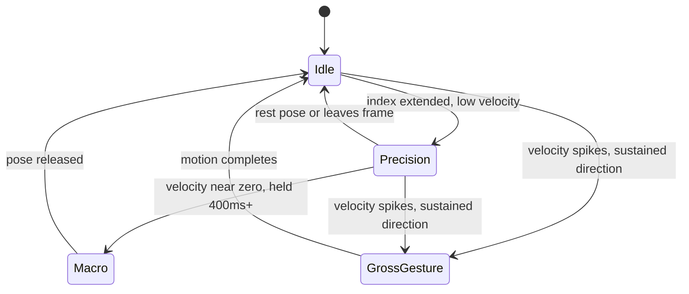

# Unified Gesture Desktop OS — Project Scope

2026-09-17 · @Anurag

## Overview

This project merges three separate gesture-control concepts — a window manager driven by gross-motor sweeps, a custom gesture-to-macro engine, and a precision accessibility pointer — into one system: a single RGB webcam replaces the mouse, keyboard shortcuts, and window manager entirely, with no gloves, wands, or extra sensors.

The unifying idea: all three are really the same hand-tracking feed read at different timescales. A held pose is a macro trigger. A slow continuous motion is a cursor. A fast committed motion is a window command. One arbitration engine classifies intent frame by frame and routes to the right subsystem — that engine, not any single mode, is the core deliverable.

**Non-goals:** no wearables, no depth camera or IR sensor requirement (should degrade gracefully to a standard laptop webcam), no third-party companion hardware.

## System architecture

Four layers, one feed:

1. **Perception** — RGB webcam → hand-landmark model (21 points/hand, both hands), 30+ fps.
2. **Feature extraction** — per frame: palm-centroid velocity, fingertip velocity relative to palm, hand-openness score, relative joint angles (scale/translation invariant), two-hand distance and symmetry.
3. **Arbitration engine** — classifies a \~250ms sliding window into one state, with hysteresis so it doesn't flicker at the boundaries.
4. **Execution** — translates the classified event into OS calls: cursor/scroll/click, a bound macro or recorded workflow, or a window-manager command.

Gross-gesture transitions pre-empt everything else once velocity crosses a hard threshold for the full window — that's what makes a real swipe unambiguous. A relaxed rest pose is a deliberate escape hatch: reaching for a coffee cup decays back to Idle instead of being force-fit into a command, because its velocity profile never resolves into a committed pattern.

## Core control modes

| Mode | Trigger | Technique |
| --- | --- | --- |
| Precision | index finger extended, moderate velocity | One Euro filter on fingertip position; thumb–index pinch = click; thumb–middle distance = scroll speed |
| Macro | motion near-zero, held 400–500ms | joint-angle vector matched against a stored template library (cosine/Euclidean distance) |
| Gross gesture | high, sustained palm-centroid velocity | left/right swipe = send window to display; two-hand pinch-pull = show desktop; closed-fist translate = drag window |

All three read from the same feature layer, so no mode needs its own tracking model or calibration pass.

## Advanced features (beyond the three source ideas)

These push past "point, click, swipe" into genuine desktop automation — still with just the one camera.

### Bimanual chording

The left hand becomes a modifier key. Holding a pose with the left hand switches interpretation context (browser vs. code editor vs. terminal) while the right hand does precision, macro, or gross-gesture work. The same physical gesture set does far more because it means something different per left-hand chord, the same way Shift changes what a keyboard key does.

### Parametric gesture sliders

Some gestures carry a continuous parameter instead of firing a fixed action: pinch distance maps to system volume, wrist rotation to zoom level, hand height to screen brightness. This needs its own smoothing pass (the same One Euro filter family as precision mode) so the parameter doesn't jitter as it's being set.

### Radial menu on demand

A held pose summons a radial (pie) menu near the hand; index-finger direction picks a wedge. This solves the scaling problem of pose-based macros — a person can reliably memorize maybe 8–12 distinct static poses, but a radial menu makes dozens of less-frequent actions reachable without growing that memorized set.

### Gesture grammar (compound sequences)

Discrete gestures chain within a short time window into compound commands — point + swipe + fist might mean "send this window to display 2 and pin it." This is a small grammar over the same primitive gesture set, letting a handful of primitives cover a combinatorially larger command space instead of needing one pose per action.

### Ray-cast window targeting and tiling

Rather than a fixed "swipe = other monitor" convention, the index finger acts as a laser pointer across the full desktop, all monitors included. A snap-zone overlay appears on gross-gesture engagement; the user points at a zone and releases a fist to drop the window there — precise placement without predefined left/right conventions.

### App-aware contextual remapping

The same physical gesture resolves to a different action depending on which application has focus — a swipe means "next slide" in a presentation app but "switch virtual desktop" on the bare desktop. This is the gesture equivalent of keyboard shortcuts differing per app, and it multiplies the useful command set without multiplying the gesture vocabulary.

### Teach-by-demonstration macro recording

Instead of hand-scripting each macro, the user performs a real sequence of actions once — open an app, arrange three windows, run a command — while an OS-level automation layer records it through the platform's accessibility/UI-automation APIs, then binds the recorded sequence to a chosen pose or grammar phrase. Any repeated workflow becomes a gesture, not just pre-built ones.

### Gesture-assisted text editing

Precision mode's index finger plus a pinch-drag selects text spans; distinct pinch variants map to copy/cut/paste. Full typing stays with the OS's built-in dictation, which is already present on the machine and so doesn't count as external hardware — gestures handle selection, editing, and correction around what's dictated, covering the one thing gesture systems alone do badly.

## Safety and trust layer

More surface area for false positives, once eight new features sit on top of the three core modes, means the safety net has to scale too.

- **Panic/freeze gesture** — both palms open and held still instantly disengages every mode; a hard kill switch independent of the arbitration engine's own state, so it works even mid-macro or mid-drag.
- **Universal undo** — one dedicated gesture always means "reverse the last action," regardless of which mode produced it.
- **Confidence HUD with dwell preview** — a small always-visible indicator shows the current mode and, during the macro dwell window, a preview of which macro is about to fire, so the user can abort before it executes.
- **Adaptive per-user calibration** — a short calibration wizard tunes velocity and dwell thresholds to the individual's baseline hand tremor and range of motion; especially important for the accessibility use case, where "normal" hand steadiness varies a lot person to person.

## Technical stack and requirements

| Layer | Approach |
| --- | --- |
| Camera | standard RGB webcam, 720p+/30fps minimum; no depth or IR sensor required |
| Hand tracking | MediaPipe Hands or equivalent on-device model, both hands, 21 landmarks each |
| Smoothing | One Euro filter (or Kalman) on fingertip and palm-centroid signals |
| Automation bridge | platform UI-automation APIs (Windows UI Automation, macOS Accessibility API, Linux AT-SPI/xdotool) to drive window moves, app launches, and recorded workflows |
| Processing | fully on-device, no frames leave the machine, given the camera is watching the user continuously |

**Latency budget:** under \~50ms glass-to-cursor for precision mode to feel like a physical mouse; macro and gross-gesture modes can tolerate the 250–500ms windows described earlier since they're discrete events, not continuous tracking.

## Risks and open questions

- **False positives at scale** — eight advanced features multiply the ways an unintended pose could fire something; the panic gesture and confidence HUD are mitigations, not a guarantee, and need real user testing to tune thresholds.
- **Fatigue ("gorilla arm")** — sustained arm-up gesturing is tiring; gross-gesture and radial-menu modes should work from a relaxed, near-desk hand position rather than requiring a raised arm.
- **Lighting and occlusion** — RGB-only tracking degrades in poor lighting or when one hand occludes the other; needs a documented fallback, such as dropping to precision-mode-only.
- **Cross-platform automation parity** — the three OS automation APIs expose different capabilities; teach-by-demonstration recordings may not transfer cleanly across platforms.
- **Open question:** how many distinct gesture-grammar sequences can an average user actually remember and execute reliably before the system becomes harder than a keyboard shortcut?

## Phased roadmap

| Phase | Scope | Unlocks |
| --- | --- | --- |
| MVP | perception + arbitration engine + precision mode only | validates the core smoothing and idle/engage/disengage logic |
| V2 | + macro mode, gross-gesture window manager, panic/undo, confidence HUD | the three original concepts, fully unified and safe to use daily |
| V3 | + bimanual chording, parametric sliders, radial menu, gesture grammar, ray-cast tiling, app-aware remapping, teach-by-demonstration recording, text-editing fusion | full desktop automation surface, gesture-only |

Ship V2 before touching any V3 feature — every V3 feature depends on the arbitration engine already being trustworthy, or it just adds more ways to misfire.
